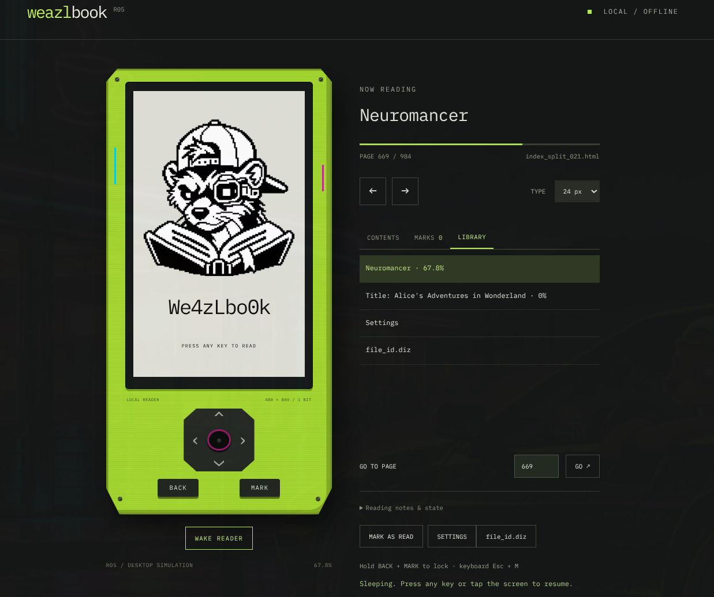

# We4zLbo0k

**Your books. Your machine. Your choice to keep—or erase.**

We4zLbo0k is a DIY pocket e-paper reader engineered for digital sovereignty. No accounts. No cloud sync. No telemetry. No radios. Zero enshittification. You buy the components, print the chassis, wire the board, and flash the firmware. You own the machine.

Weazl Knows, Weazl is Wise. Weazl never taxes the gig.



*Local browser simulator—not a photograph of validated hardware.*

## CAPABILITIES

* **Supported Formats:** EPUB, PDF, and raw Markdown, within the documented [format limits](docs/FORMATS.md).
* **Data Transfer:** Physical USB sideloading to a FAT32 SD card. No wireless transfer.
* **Reading:** Book library, completion and READ status, resume positions, bookmarks, and IBM Plex Mono text.
* **Total Ownership:** No subscriptions, no proprietary walled gardens, no over-the-air updates altering your feature set.

## THREAT MODEL & NUKE ARCHITECTURE

This deck is designed for offline ownership and deliberate control over your data. Its physical-security behavior is still an engineering prototype.

* **The Vault Lock:** A user-defined directional arrow combo locks the interface. **Locked UI = no USB storage access.** The firmware refuses to expose the SD card while locked; plugging in a cable never unlocks it. Eject and unplug an existing USB session before locking. This does not encrypt the card or protect it from physical removal.
* **The Nuke Code:** A dedicated, secondary combo triggers an immediate, zero-confirmation wipe request. Unlock and Nuke Codes use independently salted PBKDF2-HMAC-SHA256 verifiers stored inside the ESP32, separate from the SD card and firmware binary.
* **Execution:** The firmware records a persistent wipe job, then clears files, settings, bookmarks, owner information, and both codes. The current first stage logically deletes SD files; it does not instantly destroy the partition table.
* **Scorched Earth:** A resumable whole-card logical overwrite follows in the background. USB storage stays blocked throughout. The installed firmware and wipe checkpoint survive so the job can resume after power loss. Completion creates a fresh FAT32 filesystem and blank owner-info scaffold. An explicit fresh partition layout and on-screen wipe progress remain planned work.
* **Technical Reality Check:** Flash controllers use wear-leveling and can retain data outside the exposed logical address space. A sector overwrite cannot guarantee forensic-grade erasure of those cells. This prototype is not a high-risk data-protection system. See the [wipe design, limitations and validation status](docs/DEVICE_CONTROLS.md).

The simulator lets you exercise the Nuke Code safely: it clears simulated state and the virtual library, **never the original book files on your computer**. **Reset simulator** restores the demo library and clears its codes.

## ASSEMBLY

Fully self-reliant. There is no pre-assembled commercial kit.

1. **Source:** Procure the hardware from the [BOM](docs/BOM.csv).
2. **Print:** Fabricate the chassis using the [printing and calibration guide](docs/PRINTING.md).
3. **Wire:** Assemble the display, battery circuit, tactile switches, and microcontroller using the [electronics notes](docs/ELECTRONICS.md) and [assembly guide](docs/ASSEMBLY.md).
4. **Flash:** Compile and flash the ESP32 firmware over USB. It uses ESP-IDF/FreeRTOS; see the [development guide](docs/DEVELOPMENT.md).

## HARDWARE STATUS: ENGINEERING PROTOTYPE

**WARNING:** We4zLbo0k is an active engineering prototype. Physical security hardening, sleep/wake responsiveness, battery consumption, and wipe-recovery resiliency require hardware validation. No board has been flashed in this project's recorded validation, and panel initialization/update remains gated. Do not deploy in high-risk environments until the architecture is proven on your specific component loadout.

The local simulator and host tests run; firmware compiles. Neither establishes working panel hardware or a validated secure wipe. See [current status](docs/STATUS.md), [device controls](docs/DEVICE_CONTROLS.md), and [build/test instructions](docs/DEVELOPMENT.md).

---

### `file_id.diz`

```text
Title    : We4zLbo0k Sovereign Reader
Author   : thaweazl
Desc     : Offline pocket e-paper deck. EPUB/PDF/MD.
           Combo lock + Nuke Code.
           Sideload only. Locked UI = Locked USB.
           DIY build. Zero cloud. Zero radios.
Status   : Engineering prototype. Hardware validation pending.
```

The editable root [`file_id.diz`](file_id.diz) holds your reader name, contact details and "if lost" instructions. Open it from the device menu; edit it with a text editor over USB. A Nuke removes that personal information too.

New project code and parametric CAD are MIT licensed. Supplied R04 assets retain their original rights; IBM Plex Mono uses the SIL Open Font License. See [dependency and license notices](docs/DEPENDENCIES.md). No rights to redistribute imported books are granted.
